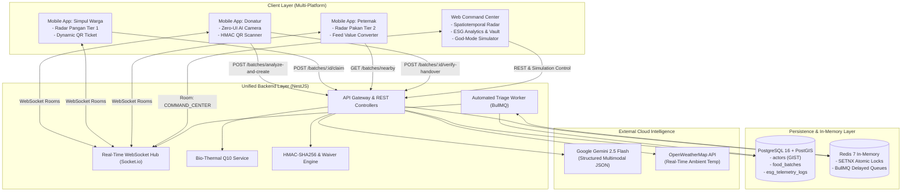
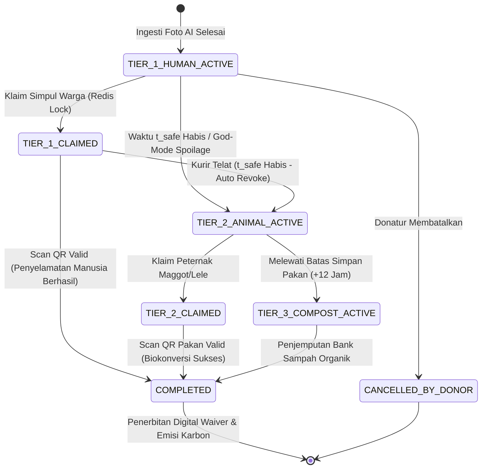

# DOKUMENTASI RESMI SISTEM SIRKULA-AI
## Real-Time Food Rescue Platform via Zero-UI Vision AI & 3-Tier Bio-Thermal Triage
### Berkas Laporan Resmi Pengembangan Aplikasi — HIMTEC 2026 Hackathon Vol. 2
**Tema Kompetisi:** *"Build App With AI — Solving Real Problems with AI and Secure Development Practices"*

---

## 1. Identitas & Ringkasan Eksekutif Proyek

### 1.1 Identitas Karya
- **Nama Aplikasi:** **SIRKULA-AI** (*Sirkulasi Pangan Cerdas & Terintegrasi*)
- **Sub-Judul:** *Platform Penyelamatan Pangan Real-Time via Zero-UI Multimodal Vision AI, Prediksi Pembusukan Bio-Termal Arrhenius ($Q_{10}$), dan 3-Tier Automated Triage*.
- **Kategori:** Web & Mobile Application (Cross-Platform Distributed Ecosystem).
- **Institusi Penyelenggara:** HIMATIF & BEM Universitas Teknologi Bandung (7–8 November 2026).

### 1.2 Ringkasan Eksekutif (*Executive Summary*)
Setiap malam di wilayah perkotaan Indonesia, ratusan kilogram makanan matang layak santap dari pesta prasmanan (pernikahan, konvensi) dan warung makan malam (Warteg, RM Padang) terbuang ke Tempat Pemrosesan Akhir (TPA). Makanan ini membusuk secara anaerobik dan melepaskan gas metana ($CH_4$) yang memiliki potensi pemanasan global $28\times$ lebih merusak dibandingkan karbon dioksida ($CO_2$). Di sisi lain, simpul warga prasejahtera mengalami kerawanan pangan, sementara peternak lokal (budidaya Maggot BSF, lele, dan unggas) terbebani biaya pakan yang mencapai $70\%$ dari total pengeluaran operasional.

Terdapat 3 hambatan fundamental (*critical pain points*) yang selama ini menggagalkan inisiatif *food rescue* konvensional:
1. **Friction Donatur yang Kelelahan:** Staf katering atau pemilik warung enggan mendonasikan sisa makanan karena proses input data manual pada aplikasi donasi biasa sangat berbelit-belit pasca-operasional fisik yang melelahkan.
2. **Ketakutan Hukum & Reputasi (*Liability Fear*):** Donatur takut dituntut secara hukum atau viral di media sosial jika makanan berlebih yang didonasikan basi di jalan dan menyebabkan keracunan.
3. **Penyaluran Buntu (*Dead-End Disposal*):** Makanan yang terlambat diambil langsung dibuang ke TPA tanpa ada mekanisme pengalihan otomatis ke sektor pakan ternak.

**SIRKULA-AI** memecahkan seluruh kendala tersebut secara radikal melalui 4 pilar rekayasa perangkat lunak:
- **Zero-UI Ingestion ($\le 15$ Detik):** Ekstraksi inventaris pangan, penaksiran porsi/bobot, kategori risiko biologis, dan rekomendasi wadah hanya dari 1 jepretan kamera via Google Gemini 2.5 Flash Structured JSON.
- **Dynamic Bio-Thermal Engine ($Q_{10}$ Decay):** Kalkulasi penurunan umur simpan mikrobiologis secara dinamis berbasis suhu cuaca ambien lokal tropis ($Q_{10} = 2.2$).
- **Automated 3-Tier Triage & Ripple Broadcast:** Pengalihan status hak klaim tanpa kompromi (*Safety Invariant*): Tier 1 (Konsumsi Manusia) $\rightarrow$ Tier 2 (Biomassa Pakan Maggot/Lele) $\rightarrow$ Tier 3 (Kompos Organik) disertai penguncian klaim terdistribusi (*Redis SETNX*).
- **Basement Blind Handshake (HMAC-SHA256):** Verifikasi serah terima tertutup di area *loading dock* bawah tanah tanpa sinyal internet, disertai penerbitan otomatis **Digital Liability Waiver Certificate** berdoktrin *Good Samaritan Law*.

### 1.3 Tabel Spesifikasi Ekosistem Multi-Platform

| Domain Sistem | Komponen / Framework | Teknologi Pendukung | Peran & Tanggung Jawab Utama |
| :--- | :--- | :--- | :--- |
| **Mobile Field App** | React Native (Expo SDK 52) | TypeScript (Strict), NativeWind (Tailwind), Zustand, TanStack Query, Expo Crypto | Aplikasi lapangan multi-peran (Donatur, Simpul Warga, Peternak). Fitur: Zero-UI Camera, Radar Misi, Dynamic QR, Scanner Offline. |
| **Unified Backend** | NestJS 10 (Node.js) | TypeScript, PostgreSQL 16 + PostGIS, Redis 7 + BullMQ, Socket.io | Gateway REST API, orkestrasi background worker $Q_{10}$, distributed atomic lock, WebSocket broadcast, verifikasi kriptografi. |
| **Web Command Center** | Native SPA / Node.js Engine | Vanilla ES2022, Pure CSS Tokens, Anime.js, Socket.io Client | Pusat pemantauan makro Pemkot/DLH, radar geospasial Kota Bandung, telemetri $Q_{10}$, audit emisi ESG, dan panel kendali *God-Mode*. |
| **AI & External Services**| Google Gemini 2.5 Flash API | OpenWeatherMap API, Expo Push / FCM | Ekstraksi multimodal citra terstruktur ($\le 2.5\text{ detik}$) dan injeksi telemetri cuaca mikro perkotaan. |
| **Basis Data Spasial** | PostgreSQL 16 + PostGIS | Geometri Spasial `Point (SRID 4326)`, Indeks `GIST` | Kueri pencarian radius hiper-lokal (`ST_DWithin`, `ST_Distance`) dan persistensi transaksional ACID. |

---

## 2. Arsitektur Sistem & Alur Kerja Inti

### 2.1 Diagram Arsitektur End-to-End (`Mermaid`)



---

### 2.2 Penjelasan Teknis 4 Inovasi Utama

#### a. Zero-UI AI Vision Ingestion ($\le 15$ Detik)
Donatur hanya perlu mengambil 1 foto nampan sisa makanan dan menggeser 1 slider jam pemaparan. Citra dikompresi di sisi klien menjadi maks $1024\times 1024\text{px}$ ($\le 800\text{ KB}$), lalu dikirim ke endpoint `POST /api/v1/batches/analyze-and-create`. Backend memanggil **Gemini 2.5 Flash** dengan parameter ketat `responseSchema` dan `responseMimeType: "application/json"`. 

AI mengekstrak metadata logistik secara deterministik:
- `batch_summary`: Ringkasan menu makanan (misal: "Gulai Cincang Sapi & Nasi Putih").
- `highest_risk_category`: Klasifikasi bahan berisiko tertinggi (misal: santan kelapa basah `WET_COCONUT_MILK`).
- `total_portions` & `total_weight_kg`: Estimasi porsi dan tonase biomassa.
- `recommended_container`: Saran wadah logistik (misal: "2 Box Kontainer Besar Bertutup").
- *Fallback Deterministik:* Jika foto buram atau koneksi AI timeout ($> 2.5\text{ detik}$), sistem secara otomatis menerapkan profil konservatif: `category = 'MOIST_PROTEIN_CARB'`, `base_shelf_life_min = 120`, `total_weight_kg = 5.0` tanpa menggagalkan proses donasi.

#### b. Mesin Bio-Termal Dinamis Arrhenius ($Q_{10}$)
Umur simpan makanan berlemak dan berkuah menyusut drastis di iklim tropis. SIRKULA-AI mengintegrasikan model kinetika mikrobiologi adaptasi hukum laju Arrhenius melalui koefisien temperatur $Q_{10}$:

$$t_{\text{safe}} = \max\left(0, \left(t_{\text{base}} \times Q_{10}^{-\left(\frac{T_{\text{ambient}} - T_{\text{ref}}}{10}\right)} \times \left[1 - \alpha \cdot \max\left(0, \frac{RH - 70}{30}\right)\right]\right) - t_{\text{exposed}} - t_{\text{buffer}}\right)$$

- **Konstanta Baku:**
  - $Q_{10} = 2.2$ (Peningkatan laju proliferasi bakteri per kenaikan $10^\circ\text{C}$).
  - $T_{\text{ref}} = 25.0^\circ\text{C}$ (Suhu ruangan referensi standar).
  - $\alpha = 0.15$ (Faktor penalti kelembaban relatif udara jika $RH > 70\%$).
  - $t_{\text{buffer}} = 20\text{ menit}$ (Toleransi durasi perjalanan kurir).
- **Klasifikasi $t_{\text{base}}$:**
  - `WET_COCONUT_MILK` (Santan/Gulai): $120\text{ menit}$.
  - `WET_NON_COCONUT` (Sop/Soto): $180\text{ menit}$.
  - `MOIST_PROTEIN_CARB` (Nasi/Ayam bumbu): $240\text{ menit}$.
  - `DRY_FRIED` (Gorengan kering/Rendang): $360\text{ menit}$.
  - `BAKERY_PASTRY` (Roti/Pastry): $480\text{ menit}$.

#### c. 3-Tier Automated Triage & Ripple Broadcast
Penyelamatan pangan dikendalikan secara mutlak oleh *State Machine* backend yang dipicu oleh timer in-memory BullMQ:
1. **Tier 1 (Konsumsi Manusia):** Dipancarkan ke simpul warga terverifikasi (Masjid, Panti Asuhan) dalam radius ripple awal $1.500\text{ meter}$.
2. **Kunci Atomik Anti Tabrakan (Redis Distributed Lock):**
   ```text
   SET lock:batch:<batch_id> <actor_id> NX EX 10
   ```
   Mencegah *race condition* jika dua kurir mengklaim batch yang sama secara simultan. Request kedua menerima `HTTP 409 Conflict`.
3. **Safety Invariant Enforcer:** Bila waktu $t_{\text{safe}}$ berakhir sebelum serah terima terjadi, sistem secara sepihak membatalkan hak klaim manusia, mencabut validitas tiket kurir, dan memutasi status ke `TIER_2_ANIMAL_ACTIVE`. Makanan dialihkan seketika ke radar peternak Maggot BSF/Lele (radius $10\text{ km}$).
4. **Tier 3 (Kompos Organik):** Jika dalam batas $t_{\text{safe}} + 12\text{ jam}$ pakan tidak dijemput, status bermutasi ke `TIER_3_COMPOST_ACTIVE` untuk diolah unit TPST kota.

#### d. Offline-First Basement Handshake (`HMAC-SHA256`) & Digital Waiver
Area serah terima hotel dan mal umumnya terletak di *loading dock basement* yang mengalami *blank spot* (tanpa sinyal internet).
- **Kriptografi Tiket QR:** Tiket QR yang dihasilkan pada aplikasi simpul warga memuat string JSON Base64URL bertanda tangan digital:
  $$\text{Signature} = \text{HMAC-SHA256}(\text{batch\_id} + \text{claim\_id} + \text{receiver\_id} + \text{expires\_at}, \text{SecretKey})$$
- **Verifikasi Lokal:** Aplikasi mobile donatur memvalidasi tanda tangan tersebut secara lokal menggunakan modul `expo-crypto` dalam tempo $< 100\text{ ms}$ tanpa memerlukan panggilan jaringan.
- **Penerbitan Digital Liability Waiver:** Saat verifikasi selesai, sistem menerbitkan sertifikat pembebasan tanggung jawab hukum berformat `SRK-ESG-202611-XXXX`. Donatur dilindungi secara mutlak oleh doktrin *Good Samaritan Law* bahwa makanan diserahkan dalam kondisi layak sebelum batas mikrobiologis habis.

---

## 3. Struktur Direktori Monorepo (`File Tree`)

```text
HIMTEC/
├── package.json                         # Root package manifest & scripts
├── docker-compose.yml                   # PostgreSQL 16 (PostGIS) & Redis 7 container
├── .env.example                         # Template variabel lingkungan monorepo
├── scripts/
│   └── dev.ps1                          # Otomasi runner 3 terminal window PowerShell
│
├── mobile/                              # React Native Expo Field App
│   ├── app.json                         # Konfigurasi Expo SDK 52 & dynamic plugins
│   ├── package.json                     # Dependensi mobile (Expo Router, NativeWind, Zustand)
│   ├── src/
│   │   ├── app/                         # File-based routing (Expo Router)
│   │   │   ├── index.tsx                # Splash gateway & session redirector
│   │   │   ├── login.tsx                # Portal autentikasi & Quick Jury Login
│   │   │   ├── onboarding.tsx           # Edukasi alur 3-tier & perizinan kamera/GPS
│   │   │   ├── (donor)/                 # Ruang kerja Donatur Makanan
│   │   │   │   ├── index.tsx            # Dashboard status batch aktif donatur
│   │   │   │   ├── camera.tsx           # Zero-UI Camera Ingestion & Exposure Slider
│   │   │   │   ├── scanner.tsx          # Pemindai QR Handshake kurir di loading dock
│   │   │   │   ├── history.tsx          # Riwayat donasi & arsip sertifikat waiver
│   │   │   │   └── profile.tsx          # Profil legalitas usaha & selector peran
│   │   │   ├── (tier1-hub)/             # Ruang kerja Simpul Warga (Konsumsi Manusia)
│   │   │   │   ├── index.tsx            # Radar geospasial pangan layak konsumsi (Tier 1)
│   │   │   │   ├── hub-radar.tsx        # Tampilan radar list & filter risiko
│   │   │   │   ├── hub-missions.tsx     # Daftar misi penjemputan aktif simpul
│   │   │   │   ├── mission/[id].tsx     # Detail loading dock & Dynamic QR Ticket
│   │   │   │   └── hub-scanner.tsx      # Scanner alternatif serah-terima
│   │   │   └── (tier2-farmer)/          # Ruang kerja Peternak Maggot BSF & Unggas
│   │   │       ├── index.tsx            # Radar biomassa pakan ternak (Tier 2)
│   │   │       ├── farmer-feed.tsx      # Feed pakan terdegradasi aman
│   │   │       ├── farmer-biomass.tsx   # Kalkulator penghematan biaya pakan ternak
│   │   │       └── farmer-history.tsx   # Riwayat pengambilan pakan
│   │   ├── components/                  # Komponen UI modular terstandarisasi
│   │   │   ├── ui/                      # Button, Card, Badge, Toast, Countdown, Input
│   │   │   ├── donor/                   # ExposureSlider, BatchPreviewModal
│   │   │   ├── farmer/                  # FeedValueCard (Kalkulator pakan Maggot)
│   │   │   └── shared/                  # DynamicQrTicket, CountdownTimer, AppHeader
│   │   ├── store/                       # Zustand state stores (useActorStore, useOfflineHandshakeQueue)
│   │   ├── lib/                         # api.ts, http.ts, mappers.ts, esg-converter.ts, socket.ts
│   │   ├── utils/                       # offlineHmacVerifier.ts, haptics.ts
│   │   ├── config/                      # env.ts (Zod validation), theme.ts (Design tokens)
│   │   └── types/                       # Definisi antarmuka TypeScript lokal
│
├── backend/                             # NestJS Unified Backend Engine
│   ├── apps/backend/
│   │   ├── src/
│   │   │   ├── main.ts                  # Bootstrap NestJS (Port 4000), Swagger docs, CORS
│   │   │   ├── modules/
│   │   │   │   ├── auth/                # Multi-role token generator & actor profile
│   │   │   │   ├── batches/             # Ingesti, PostGIS query (ST_DWithin), state mutation
│   │   │   │   ├── vision-ai/           # Google Gemini 2.5 Flash SDK integration
│   │   │   │   ├── weather/             # OpenWeatherMap client & tropical fallback
│   │   │   │   ├── triage-worker/       # BullMQ processor pembusukan bio-termal
│   │   │   │   ├── claims/              # Redis SETNX atomic lock & HMAC QR generator
│   │   │   │   ├── esg-analytics/       # Perhitungan reduksi karbon & PDF waiver generator
│   │   │   │   ├── simulation/          # God-Mode Time-Warp & temperature override
│   │   │   │   └── websocket/           # Socket.io gateway & room broadcasters
│   │   │   ├── common/                  # Guards (ActorRoleGuard), Filters, Middleware
│   │   │   └── database/                # DatabaseModule (pg pool connection)
│   └── packages/
│       ├── shared-types/                # Kontrak Zod DTO, Enums, dan Event Socket.io
│       ├── bio-thermal-sdk/             # Pure math: Rumus Arrhenius Q10 & konversi ESG
│       └── database/                    # Skema SQL, migrasi, dan seed data Bandung
│
└── web/                                 # Web Command Center & ESG Executive Dashboard
    ├── index.html                       # HTML5 Shell, Socket.io CDN, Plus Jakarta Sans
    ├── server.cjs                       # Native Node.js HTTP Server (Port 3000)
    ├── package.json                     # Manifest web & Anime.js dependency
    └── src/
        ├── main.js                      # Entry point, router, event delegator, dialogs
        ├── router.js                    # SPA hashless client-side router & route guards
        ├── store.js                     # State machine reaktif, WebSocket bridge, storage
        ├── api.js                       # Fetch API wrapper, JWT auth, alias mapper
        ├── socket.js                    # Socket.io client singleton & event broadcaster
        ├── views.js                     # Template komponen UI (Radar, Q10, ESG, God-Mode)
        └── styles.css                   # Sistem desain CSS tokens & dark telemetry theme
```

---

## 4. Panduan Instalasi, Konfigurasi & Menjalankan Aplikasi

### 4.1 Prasyarat Perangkat Lunak
- **Node.js:** Versi 20.x LTS atau lebih baru.
- **NPM / PNPM:** Package manager (`npm install -g pnpm`).
- **Docker Desktop:** Untuk menjalankan kontainer PostgreSQL 16 (PostGIS) dan Redis 7.
- **Android Studio / Expo Go:** Android Studio Emulator (AVD API 34+) atau aplikasi Expo Go pada perangkat fisik Android/iOS.

---

### 4.2 Langkah Demi Langkah Menjalankan Seluruh Ekosistem

#### Langkah 1: Jalankan Basis Data (Docker)
Buka terminal PowerShell pada direktori `backend/`:
```powershell
cd backend
docker compose up -d
```
*Pastikan kedua container (`sirkula-postgres` port 5432 dan `sirkula-redis` port 6379) berstatus healthy.*

Jalankan inisialisasi skema dan seeding data geospasial Kota Bandung:
```powershell
pnpm db:migrate
pnpm db:seed
```

#### Langkah 2: Jalankan 3 Platform Sekaligus via Skrip Otomasi
Dari direktori root `HIMTEC/`, jalankan skrip orkestrasi PowerShell otomatis:
```powershell
.\scripts\dev.ps1
```
Skrip ini akan membuka 3 jendela terminal independen secara paralel:
1. **Jendela 1 (Backend NestJS):** Berjalan di `http://localhost:4000` (Dokumentasi Swagger di `http://localhost:4000/api/docs`).
2. **Jendela 2 (Web Command Center):** Berjalan di `http://localhost:3000`.
3. **Jendela 3 (Mobile Expo Metro):** Berjalan di `http://localhost:8081`.

---

### 4.3 Menjalankan Mobile App di Berbagai Target Lingkungan

Konfigurasikan file `mobile/.env` sesuai target perangkat pengujian:

#### A. Pengujian Cepat di Web Browser (Expo Web)
Sangat dianjurkan untuk evaluasi cepat antarmuka tanpa emulator berat:
```env
EXPO_PUBLIC_USE_MOCK=false
EXPO_PUBLIC_API_URL=http://localhost:4000
EXPO_PUBLIC_SOCKET_URL=http://localhost:4000
EXPO_PUBLIC_HMAC_SECRET_KEY=sirkula-super-secure-hmac-secret-key-32chars
```
Pada terminal `mobile/`, tekan tombol **`w`** untuk membuka Expo di browser Google Chrome.

#### B. Pengujian di Android Studio Emulator (AVD)
Emulator Android memetakan localhost komputer pengembang ke alamat IP khusus `10.0.2.2`:
```env
EXPO_PUBLIC_USE_MOCK=false
EXPO_PUBLIC_API_URL=http://10.0.2.2:4000
EXPO_PUBLIC_SOCKET_URL=http://10.0.2.2:4000
EXPO_PUBLIC_HMAC_SECRET_KEY=sirkula-super-secure-hmac-secret-key-32chars
```
Pastikan `ANDROID_HOME` telah disetel di environment variables Windows, lalu tekan tombol **`a`** di terminal Expo.

#### C. Pengujian di HP Fisik (Expo Go via Wi-Fi LAN)
Gunakan alamat IP lokal komputer Anda (cek melalui perintah `ipconfig` di PowerShell):
```env
EXPO_PUBLIC_USE_MOCK=false
EXPO_PUBLIC_API_URL=http://192.168.1.100:4000
EXPO_PUBLIC_SOCKET_URL=http://192.168.1.100:4000
EXPO_PUBLIC_HMAC_SECRET_KEY=sirkula-super-secure-hmac-secret-key-32chars
```
Pindai kode QR Metro Bundler menggunakan aplikasi **Expo Go** di ponsel.

---

### 4.4 Fitur Ketahanan: Hybrid Dual-Mode / Standalone Fallback
SIRKULA-AI dilengkapi dengan arsitektur **Zero-Failure Demonstration**:
- Saat aplikasi mobile dibuka, modul `src/lib/api.ts` melakukan *probe health check* selama 3 detik ke backend.
- Jika backend belum menyala atau database offline, aplikasi **TIDAK CRASH**, melainkan secara anggun mengaktifkan **Standalone Demo Mode** (ditandai dengan badge khusus pada header).
- Seluruh alur (Login Juri 1-Tap, Simulasi Kamera AI, Radar Misi, Tiket Dynamic QR, Scanner HMAC, hingga Kalkulator Maggot) dapat didemokan secara penuh dan interaktif menggunakan mesin in-memory mock.
- Ketika server backend dinyalakan kembali, pengguna cukup mengetuk tombol *"Coba sambungkan lagi"* pada status bar untuk kembali ke mode sinkronisasi database live PostgreSQL.

---

## 5. Panduan Penggunaan & Skenario Pengujian Live Demo

Aplikasi menyediakan **Quick Jury Portal** pada halaman login untuk berganti ke 4 peran utama secara instan:

### a. Peran Donatur (Hotel / Restoran / Katering)
1. **Login 1-Ketukan:** Pada layar login, ketuk kartu **"Donor Pangan"** (*Sabuga ITB Catering*).
2. **Kamera Ingesti Zero-UI:** Ketuk tab tengah kamera di navigasi bawah.
3. **Simulasi / Jepret Foto:** Ambil foto makanan prasmanan atau gunakan preset demo foto gulai sapi.
4. **Parameter Bio-Termal:** Geser slider durasi paparan (pilihan: *Baru Matang*, *$\le 2$ Jam*, *$\le 4$ Jam*) dan aktifkan toggle *Ruangan Ber-AC*.
5. **Rilis ke Radar:** Ketuk **"⚡ Analisis & Selamatkan"**. AI Gemini 2.5 Flash mengekstrak metadata dalam $< 2.5\text{ detik}$. Tinjau kartu estimasi porsi (40 porsi, 10 kg), lalu ketuk **"Konfirmasi Rilis Batch"**.
6. **Verifikasi Serah-Terima:** Ketika kurir tiba di loading dock, buka menu scanner, arahkan kamera ke tiket QR kurir. Transaksi terverifikasi seketika dan **Sertifikat Digital Liability Waiver** resmi langsung diterbitkan.

### b. Peran Simpul Warga (Tier 1 Hub — Masjid / Panti Asuhan)
1. **Login Simpul Warga:** Masuk menggunakan akun *DKM Masjid Raya Al-Ukhuwah*.
2. **Pantau Radar Hiper-Lokal:** Buka tab beranda: sistem menampilkan batch makanan aktif dalam radius $1.5\text{ km}$ dengan koordinat presisi tersamar (*obfuscated*) demi privasi donatur.
3. **Countdown Bio-Termal:** Amati hitung mundur dinamis yang berdetak mundur per detik menunjukkan sisa jendela aman mikrobiologis ($t_{\text{safe}}$).
4. **Klaim Misi Penyelamatan:** Ketuk tombol **"Ambil Misi Penyelamatan"**. Sistem mengunci kuota via Redis SETNX. Halaman detail misi terbuka, menampilkan alamat loading dock presisi serta **Dynamic QR Ticket** bertanda tangan kriptografis HMAC-SHA256.
5. **Uji Safety Invariant Lock:** Jika waktu aman habis sebelum tiba di lokasi, tiket QR otomatis terkunci dengan banner merah: *"Waktu Konsumsi Manusia Habis demi Keselamatan Pangan"*.

### c. Peran Mitra Peternak (Tier 2 Farmer — Budidaya Maggot BSF / Lele)
1. **Login Peternak:** Masuk sebagai *Peternakan Maggot BSF Mandiri Cibiru*.
2. **Pantau Radar Pakan Organik:** Buka radar Tier 2: batch makanan yang telah melewati batas aman manusia (atau dipicu time-warp) otomatis muncul dengan label amber (`#F59E0B`).
3. **Kalkulator Nilai Pakan (`FeedValueCard`):** Ketuk kartu batch untuk melihat kalkulasi nilai ekonomi: bobot biomassa pakan (kg), estimasi konversi larva Maggot BSF, dan nominal penghematan biaya pakan pabrikan (Rp 3.800/kg).
4. **Klaim & Penjemputan:** Ambil misi pakan, tunjukkan QR serah-terima pakan kepada donatur.

### d. Peran Dewan Juri / Simulator Admin (God-Mode Panel di Web)
1. Buka Web Command Center di `http://localhost:3000`, login sebagai `admin@sirkula.demo` (Password: `demo123`).
2. **Manipulasi Suhu Tropis:** Pada panel kanan, geser slider suhu dari $28^\circ\text{C}$ ke $38^\circ\text{C}$. Perhatikan bagaimana rumus Arrhenius $Q_{10}$ di backend langsung memangkas jendela aman sisa makanan secara drastis.
3. **Trigger Spoilage (Time-Warp):** Tekan tombol merah **"⚡ TRIGGER INSTANT BIO-THERMAL SPOILAGE (TIER 2)"**. Dalam tempo $< 100\text{ ms}$, perhatikan:
   - Layar misi simpul warga di mobile seketika terkunci.
   - Batch berpindah secara real-time ke radar peternak Maggot.
   - Pin peta di Web Command Center berubah warna dari Hijau menjadi Kuning Amber.
4. **1-Tap Reset Demo:** Tekan tombol reset di bagian bawah untuk membersihkan state pengujian kembali ke data awal.

---

## 6. Dokumentasi Kontrak API (REST Endpoints & WebSocket Events)

### 6.1 Tabel 5 Endpoint REST Utama

| Method & Route | Peran yang Diizinkan | Format Request Body | Format Response (Sukses) | Penanganan Safety Invariant & Error |
| :--- | :--- | :--- | :--- | :--- |
| **`GET /api/v1/auth/actors`** | Publik / Demo | *None* | `200 OK`<br/>`[{ id, name, role, address_full, location, handover_point_notes }]` | Digunakan sekaligus sebagai probe health check backend (timeout 3s). |
| **`POST /api/v1/batches/analyze-and-create`** | `DONOR` | `multipart/form-data`<br/>- `image`: File (JPEG/PNG)<br/>- `latitude`: Float<br/>- `longitude`: Float<br/>- `exposed_minutes`: Int<br/>- `is_ac_room`: Bool | `201 Created`<br/>`{ batch_id, batch_summary, detected_items: [], environmental_metrics: {}, bio_thermal_timings: { safe_window_human_min, tier1_expires_at, tier2_expires_at }, current_state: "TIER_1_HUMAN_ACTIVE" }` | Jika Vision AI gagal, sistem menerapkan *conservative fallback* (`HTTP 201`). Validasi input gagal mengembalikan `HTTP 400`. |
| **`GET /api/v1/batches/nearby`** | Semua Peran | Query: `?lat=&lng=&radius_meters=&role=` | `200 OK`<br/>`[{ id, batch_summary, highest_risk_category, total_portions, total_weight_kg, current_state, tier1_expires_at, obfuscated_location: { latitude, longitude } }]` | Lokasi presisi dan `handover_point_notes` **wajib disembunyikan** dari respons publik (hanya `obfuscated_location`). |
| **`POST /api/v1/batches/:id/claim`** | `TIER_1_HUB`, `TIER_2_FARMER` | `{}` (Headers: `x-actor-id`, `x-actor-role`) | `200 OK`<br/>`{ claim_id, batch_id, exact_pickup_location: { latitude, longitude }, handover_point_notes, qr_token: "HM-..." }` | **Atomic Lock:** Memanggil Redis `SETNX`. Jika batch sudah diklaim, melempar `HTTP 409 Conflict`. Jika waktu habis, melempar `HTTP 422`. |
| **`POST /api/v1/batches/:id/verify-handover`** | `DONOR` | `{ qr_payload: "string-token" }` | `200 OK`<br/>`{ batch_id, current_state: "COMPLETED", final_rescued_tier, waiver_certificate_no: "SRK-ESG-...", waiver_signature_hash }` | **Safety Invariant:** Jika `NOW() >= tier1_expires_at` pada klaim Tier 1, backend **menolak mutlak (`HTTP 422 Unprocessable Entity`)** dan mengalihkan batch ke Tier 2. |

---

### 6.2 Contoh Payload REST API Nyata

#### Request Ingesti: `POST /api/v1/batches/analyze-and-create`
```http
POST /api/v1/batches/analyze-and-create HTTP/1.1
Host: localhost:4000
Content-Type: multipart/form-data; boundary=----WebKitFormBoundary7MA4YWxkTrZu0gW

------WebKitFormBoundary7MA4YWxkTrZu0gW
Content-Disposition: form-data; name="latitude"

-6.8863
------WebKitFormBoundary7MA4YWxkTrZu0gW
Content-Disposition: form-data; name="longitude"

107.6080
------WebKitFormBoundary7MA4YWxkTrZu0gW
Content-Disposition: form-data; name="exposed_minutes"

120
------WebKitFormBoundary7MA4YWxkTrZu0gW
Content-Disposition: form-data; name="is_ac_room"

true
------WebKitFormBoundary7MA4YWxkTrZu0gW
Content-Disposition: form-data; name="image"; filename="gulai_prasmanan.jpg"
Content-Type: image/jpeg

<binary-data-terkompresi>
------WebKitFormBoundary7MA4YWxkTrZu0gW--
```

#### Response Ingesti (`201 Created`):
```json
{
  "batch_id": "b7c2a1e4-9f83-4312-b58a-6412bf709123",
  "batch_summary": "Gulai Cincang Sapi & Nasi Putih",
  "highest_risk_category": "WET_COCONUT_MILK",
  "total_portions": 40,
  "total_weight_kg": 10.0,
  "recommended_container": "2 Box Kontainer Besar Bertutup",
  "environmental_metrics": {
    "ambient_temp_c": 31.5,
    "humidity_pct": 78,
    "effective_temp_c": 22.0
  },
  "bio_thermal_timings": {
    "base_shelf_life_min": 120,
    "safe_window_human_min": 74,
    "tier1_expires_at": "2026-11-07T14:35:00.000Z",
    "tier2_expires_at": "2026-11-08T02:35:00.000Z"
  },
  "current_state": "TIER_1_HUMAN_ACTIVE"
}
```

---

### 6.3 Tabel Event Real-Time WebSocket (Socket.io)

| Nama Event | Room Tujuan | Payload JSON | Dampak Komponen UI Klien |
| :--- | :--- | :--- | :--- |
| **`batch:created`** | `room:COMMAND_CENTER`, `room:TIER_1_HUB` | `{ batch_id, batch_summary, total_portions, total_weight_kg, current_state, tier1_expires_at, obfuscated_location }` | Menambahkan kartu makanan baru ke Radar Warga Mobile dan memunculkan pin hijau di Peta Web secara instan. |
| **`batch:claimed`** | `room:COMMAND_CENTER` | `{ batch_id, claim_id, actor_name, claimed_for_tier }` | Memperbarui badge status batch menjadi `CLAIMED`, mengunci tombol klaim publik. |
| **`batch:state_transitioned`** | `room:COMMAND_CENTER`, `room:TIER_1_HUB`, `room:TIER_2_FARMER` | `{ batch_id, previous_state, new_state, reason, next_expires_at }` | Mengunci layar kurir manusia (Tier 1), memindahkan batch ke Radar Pakan Ternak (Tier 2), dan mengubah pin peta web menjadi kuning. |
| **`batch:handover_completed`** | `room:COMMAND_CENTER`, `room:DONOR` | `{ batch_id, final_rescued_tier, weight_saved_kg, co2e_avoided_kg, waiver_certificate_no }` | Menampilkan modal sukses serah terima, menggerakkan counter emisi $CO_2e$ naik, dan menerbitkan Sertifikat Waiver resmi. |

---

## 7. Dokumentasi Skema Database & Katalog State

### 7.1 Tabel Relasional Utama (PostgreSQL 16 + PostGIS)

#### 1. Tabel `actors` (Master Pengguna & Titik Spasial)
- `id` (UUID PK, default `gen_random_uuid()`).
- `name` (VARCHAR 150), `role` (`actor_role_enum`), `email`, `phone_whatsapp`.
- `location` (`GEOGRAPHY(Point, 4326)`): Titik koordinat asli berindeks `GIST`.
- `address_full` (TEXT), `handover_point_notes` (TEXT &ndash; instruksi pintu belakang).
- `priority_score` (INT 1-100 &ndash; bobot prioritas simpul rentan).

#### 2. Tabel `food_batches` (Entitas Utama Siklus Hidup Pangan)
- `id` (UUID PK), `donor_id` (UUID FK ke `actors.id`).
- `image_url` (TEXT), `batch_summary` (VARCHAR 255), `vision_raw_json` (JSONB).
- `highest_risk_category` (`food_risk_category_enum`).
- `total_portions` (INT), `total_weight_kg` (NUMERIC 8,2).
- `current_state` (`batch_state_enum`): Indeks B-Tree untuk query status instan.
- `ambient_temp_c` (NUMERIC 4,1), `safe_window_human_min` (INT).
- `tier1_expires_at` (TIMESTAMPTZ), `tier2_expires_at` (TIMESTAMPTZ).
- `obfuscated_location` (`GEOGRAPHY(Point, 4326)`): Koordinat dengan pergeseran acak (*jitter* 200&ndash;300m) untuk privasi publik.

#### 3. Tabel `rescue_claims` (Klaim & Kriptografi Serah Terima)
- `id` (UUID PK), `batch_id` (UUID FK), `receiver_id` (UUID FK ke `actors.id`).
- `claimed_for_tier` (VARCHAR 20 &ndash; `TIER_1_HUMAN` atau `TIER_2_ANIMAL`).
- `qr_handshake_token` (VARCHAR 255): Hash HMAC tanda tangan serah terima.
- `status` (`claim_status_enum`): `ACTIVE_EN_ROUTE`, `HANDOVER_COMPLETED`, `EXPIRED_AUTO_REVOKED`.

#### 4. Tabel `esg_telemetry_logs` (Buku Besar Dampak Lingkungan)
- `id` (UUID PK), `batch_id` (UUID FK), `donor_id` (UUID FK), `receiver_id` (UUID FK).
- `weight_saved_kg` (NUMERIC 8,2), `portions_saved` (INT).
- `co2e_avoided_kg` (`NUMERIC GENERATED ALWAYS AS (weight_saved_kg * 2.50) STORED`).
- `methane_ch4_avoided_kg` (`NUMERIC GENERATED ALWAYS AS (weight_saved_kg * 0.15) STORED`).
- `estimated_feed_savings_idr` (`NUMERIC GENERATED ALWAYS AS (weight_saved_kg * 3800.00) STORED`).
- `waiver_certificate_no` (VARCHAR 64 UNIQUE), `waiver_signature_hash` (VARCHAR 64).

#### 5. Tabel `batch_state_audit_logs` (Audit Mutasi Tak Terbantahkan)
- Mencatat seluruh riwayat mutasi status, aktor pengubah, sumber pemicu (`INITIAL_INGESTION`, `BULLMQ_BIO_TIMER`, `GOD_MODE_SIMULATOR`), dan catatan teknis.

---

### 7.2 Diagram Mesin Status (*State Transition Diagram*)



---

## 8. Katalog Layar Antarmuka (UI Screen Reference & Slot Screenshot)

Berikut adalah daftar tampilan antarmuka terstruktur aplikasi SIRKULA-AI yang siap dilengkapi tangkapan layar (*screenshot*) beresolusi tinggi sebelum pencetakan laporan akhir:

### 1. Layar Masuk & Quick Jury Login Portal (Mobile)
*Pintu masuk aplikasi yang dilengkapi portal pintas 1-ketukan untuk dewan juri menguji seluruh peran aktor.*


### 2. Layar Dashboard Utama Donatur Pangan (Mobile)
*Pusat pemantauan batch donasi aktif donatur dengan indikator hitung mundur bio-termal dan status kurir.*


### 3. Layar Zero-UI AI Vision Camera & Exposure Slider (Mobile)
*Antarmuka pengambilan foto makanan sisa dengan panduan sudut hijau, slider waktu paparan, dan toggle pendingin ruangan.*


### 4. Modal Pratinjau Analisis Multimodal AI Gemini (Mobile)
*Hasil ekstraksi instan kecerdasan buatan: nama menu, estimasi porsi, berat (kg), kategori risiko santan, dan rekomendasi wadah.*


### 5. Layar Radar Hiper-Lokal Simpul Warga Tier 1 (Mobile)
*Daftar makanan layak konsumsi manusia dalam radius 1.5 km dengan lokasi tersamar dan timer degradasi mikroba.*


### 6. Layar Detail Misi Penjemputan & Dynamic QR Ticket (Mobile)
*Instruksi pintu belakang loading dock dan tiket QR dinamis bertanda tangan kriptografis HMAC-SHA256 untuk serah terima.*


### 7. Layar Pemindai QR Handshake Loading Dock (Mobile)
*Kamera scanner native berkecepatan tinggi milik donatur untuk memverifikasi QR kurir secara lokal tanpa sinyal internet.*


### 8. Layar Radar Biomassa Pakan Ternak Tier 2 (Mobile)
*Radar pakan organik aman untuk peternak Maggot BSF dan lele dari makanan yang bermutasi otomatis dari Tier 1.*


### 9. Layar Kalkulator Nilai Ekonomi Pakan Maggot (Mobile)
*Kalkulator konversi biomasa pangan menjadi penghematan rupiah biaya operasional peternak lokal.*


### 10. Layar Riwayat & Sertifikat Digital Liability Waiver (Mobile)
*Buku besar serah terima makanan dan sertifikat pembebasan tanggung jawab hukum Good Samaritan bertanda tangan digital.*


### 11. Layar Agregat Dampak Lingkungan & ESG Analytics (Mobile)
*Metrik real-time porsi terselamatkan, kilogram timbulan sampah dicegah, dan reduksi emisi gas metana/CO2e.*


### 12. Layar Web Command Center & Spatiotemporal Radar Kota Bandung (Web)
*Pusat komando pemantauan makro Pemkot dan panel simulasi kendali cuaca/time-warp dewan juri.*

