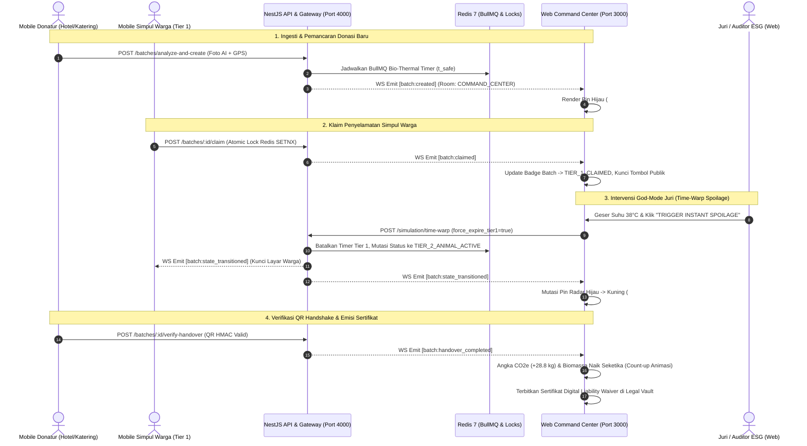

# DOKUMENTASI RESMI WEB COMMAND CENTER & ESG EXECUTIVE DASHBOARD
## SIRKULA-AI: Real-Time Food Rescue Platform

---

## 1. Peran & Fungsi Web Command Center dalam Ekosistem SIRKULA-AI

**Web Command Center SIRKULA-AI** (`web/`) adalah pusat komando operasional, pemantauan spasial terpadu (*Spatial Operations Tower*), dan portal audit ESG (*Environmental, Social, and Governance*) tingkat eksekutif. Sistem ini dirancang untuk memberikan transparansi makro dan kendali terpusat bagi tiga pemangku kepentingan utama:

1. **Pemerintah Daerah (Pemkot Bandung & Dinas Lingkungan Hidup / Dinas Ketahanan Pangan):**
   - Pemantauan real-time sirkulasi pangan berlebih di seluruh distrik kota (Coblong, Dago, Wastukencana, Lengkong, Cibiru, Kopo).
   - Pengawasan mitigasi gas metana ($CH_4$) dari Tempat Pemrosesan Akhir (TPA Sarimukti) dan pengurangan beban timbulan sampah organik perkotaan.
2. **Auditor ESG Korporat & Manajemen CSR (Jaringan Hotel, Restoran, dan Katering):**
   - Pelacakan kuantitatif dampak lingkungan terverifikasi: biomassa terselamatkan (kg), emisi setara karbon dihindari ($CO_2e$), serta konversi nilai ekonomi pakan ternak.
   - Akses terpusat ke **Digital Liability Vault** untuk mengunduh dan mencetak sertifikat pembebasan tanggung jawab hukum berdoktrin *Good Samaritan Law* bertanda tangan kriptografis `HMAC-SHA256`.
3. **Pusat Kendali Simulasi Dewan Juri (*God-Mode Control Tower*):**
   - Panel kendali intervensi langsung untuk menguji ketahanan protokol keselamatan pangan (*Safety Invariant Enforcer*), manipulasi suhu mikroklimat tropis, dan percepatan waktu pembusukan biologis (*Time-Warp Spoilage*).

### Tabel Spesifikasi Teknologi Modul Web (`web/`)

| Komponen Arsitektur | Teknologi / Standar Terpasang | Deskripsi Teknis & Justifikasi Implementasi |
| :--- | :--- | :--- |
| **Arsitektur Frontend** | Vanilla ES Modules (ES2022) + Single Page Architecture (SPA) | Arsitektur *zero-overhead* tanpa kompilasi berat, *instant hot reload*, dan waktu inisialisasi browser $< 150\text{ ms}$. |
| **Runtime & Dev Server** | Node.js Built-in HTTP Server (`server.cjs`) | Server HTTP native tanpa dependensi eksternal berat, kompatibel dengan Node.js $\ge 20$. |
| **Design System & Styling** | Pure CSS3 + Custom Design Tokens (`DESIGN.md`) | Variabel tema `:root` dengan palet warna resmi (`#0B7A6B`, `#0FA690`, `#F59E0B`, `#10B981`, `#EF4444`). Dilengkapi *Dark Telemetry Theme* (`#0F172A`, `#1E293B`, `#334155`) khusus Command Center. |
| **Tipografi** | Plus Jakarta Sans & JetBrains Mono | Font modern dari Google Fonts untuk kejelasan teks operasional dan format monospace untuk hash SHA-256 serta timer telemetri. |
| **Animasi & Interaksi** | Anime.js `v4.5.0` + CSS Keyframes Hardware Accelerated | Transisi animasi halus pada pembaruan radar spasial, ripple pulses, dan visualisasi bar metrik. |
| **Peta Geospasial Interaktif** | Spatiotemporal Radar Bandung (Vector Grid Canvas) | Pemetaan koordinat PostGIS berbasis grid topografi Bandung, zonasi radius dispersi (*Ripple Broadcast* 500m &ndash; 1.500m &ndash; 5.000m), dan pin penanda status interaktif. |
| **Visualisasi Data ESG** | Pure SVG Reactive Visualizations & Dynamic Metric Cards | Bar chart rasio penyelamatan Tier 1 vs Tier 2 vs Tier 3, KPI card agregat karbon, dan timeline log mutasi sistem. |
| **Protokol Sinkronisasi** | Socket.io Client `4.8.1` (`https://cdn.socket.io/4.8.1/socket.io.min.js`) | Komunikasi dupleks penuh (*full-duplex*) mendengarkan event room `COMMAND_CENTER` pada port `4000`. |
| **Ketahanan Sistem** | Hybrid Standalone Fallback & Health Probe Engine | Auto-switch ke simulasi in-memory/localStorage jika server backend belum aktif, memastikan juri dapat menguji 100% fitur kapan saja. |

---

## 2. Arsitektur Frontend Web & Sinkronisasi Lintas Platform

Web Command Center beroperasi secara terhubung (*coupled*) dengan NestJS Backend melalui REST API dan WebSocket Gateway, sekaligus tersinkronisasi mulus dengan aplikasi Mobile yang dioperasikan para aktor di lapangan.

### Diagram Alur Data Sinkronisasi Real-Time (`Mermaid`)



### Mekanisme Pembaruan UI Reaktif Tanpa Reload (*Zero-Reload Reactivity*)
1. **Rilis Donasi via Kamera AI:** Ketika donatur menekan tombol konfirmasi di mobile, NestJS memancarkan event `batch:created`. Web Command Center yang sedang membuka halaman `/dashboard` langsung menangkap event tersebut via `socket.on('batch:created')`. State lokal `store.js` memperbarui array `batches`, memicu penambahan pin hijau baru pada radar peta dan memunculkan toast banner secara instan.
2. **Klaim Warga & Kunci Atomik:** Saat simpul warga mengklaim misi, event `batch:claimed` mengunci kartu pada antarmuka web sehingga petugas pemkot mengetahui bahwa batch makanan tersebut telah memiliki kurir penjemput resmi.
3. **Pembusukan Bio-Thermal & Time-Warp:** Bila timer $t_{\text{safe}}$ berakhir atau juri menekan tombol *Instant Spoilage* di panel web, backend mengeksekusi transisi status ke `TIER_2_ANIMAL_ACTIVE`. Event `batch:state_transitioned` menyebabkan pin radar seketika berubah warna menjadi oranye/kuning (`#F59E0B`), kartu telemetri beralih ke indikator pakan ternak, dan entri baru dicatat pada *Live Mutation Stream*.
4. **Serah Terima & Konfirmasi Kriptografis:** Pemindaian QR di loading dock memicu `batch:handover_completed`. Komponen metrik ESG di web langsung mengkalkulasi penambahan bobot riil, menggeser nilai emisi $CO_2e$ ke atas, serta meregenerasi tabel buku besar sertifikat hukum.

---

## 3. Struktur Direktori Modul `web/` (`File Tree`)

```text
web/
├── index.html                  # Dokumen induk HTML5, font loader, Socket.io CDN, shell container
├── server.cjs                  # Server HTTP native Node.js (Port 3000, MIME handling, security headers)
├── package.json                # Manifest proyek, metadata demo, script dev/check/smoke, dependensi Anime.js
├── Dockerfile                  # Container deployment standalone berbasis Node.js 20 Alpine
├── assets/                     # Koleksi aset grafis SVG, ilustrasi persona, dan favicon
│   ├── favicon.svg             # Logo visual resmi SIRKULA-AI
│   ├── food-rescue-scenes.png  # Banner skenario penyelamatan makanan
│   ├── penyedia1.png - 3.png   # Ilustrasi donatur hotel, restoran, dan katering
│   ├── manggot.png             # Ilustrasi budidaya biokonversi Maggot BSF
│   └── tier2-farmer.png        # Ilustrasi persona mitra peternak Tier 2
├── scripts/                    # Skrip pengujian otomatis dan verifikasi sintaks
│   ├── check.js                # Linter sintaks JavaScript, route validator, dan verifikasi aset
│   └── smoke.mjs               # Smoke test HTTP otomatis memastikan endpoint lokal merespons 200 OK
├── src/                        # Sumber kode aplikasi frontend Web Command Center
│   ├── main.js                 # Entry point, router listener, event delegator, dialog handler, bootstrap
│   ├── router.js               # Client-side router SPA (getRoute, navigate, route guards, URL params)
│   ├── store.js                # State machine reaktif, normalisasi data, sinkronisasi WebSocket, storage
│   ├── api.js                  # HTTP Client REST API (fetch wrapper, Bearer JWT, alias mapping, error handler)
│   ├── socket.js               # Inisialisasi Socket.io Client, auto-reconnect, join rooms, custom event bridge
│   ├── views.js                # Komponen antarmuka modular (Overview, Map, Analytics, Legal Vault, Simulation)
│   ├── services.js             # Generator estimasi offline & mock AI vision validator
│   ├── data.js                 # Konstanta master (Roles, FoodRiskCategories, BatchStates, Koordinat Bandung)
│   └── styles.css              # Sistem desain CSS lengkap, layout grid, dark mode command center, badges
```

### Tanggung Jawab Modul Inti:
- **`src/main.js`:** Bertindak sebagai orkestrator antarmuka. Mengatur inisialisasi aplikasi, *route guards* (memastikan pengguna login sebelum membuka menu internal), menangani aksi form (`data-form`), interaksi tombol modal dialog, pemanggilan toast pemberitahuan, serta rendering ulang reaktif melalui pemanggilan `render(route, state)`.
- **`src/store.js`:** Pengelola *single source of truth* state aplikasi di sisi web. Menampung data aktor aktif, daftar batch pangan, log audit mutasi, dan rekapitulasi ESG. Mengimplementasikan fungsi mutator atomik `update()`, penyimpanan persisten ke `localStorage`, dan mendaftarkan *event listener* `sirkula:batch-*` untuk sinkronisasi WebSocket.
- **`src/views.js`:** Kumpulan fungsi murni (*pure template functions*) yang menghasilkan markup HTML responsif:
  - `renderCommandCenterOverview()`: Tata letak *split grid* 65/35 (Radar Spasial di kiri, Telemetri Q10 & God-Mode di kanan, dan 4 Kartu KPI ESG di footer).
  - `mapSketch()`: Mesin visualisasi radar geospasial Kota Bandung berlatar gelap.
  - `analyticsPage()`: Dashboard grafik analitik emisi karbon dan dekomposisi jalur penyelamatan.
  - `legalVaultPage()`: Arsip sertifikat pembebasan hukum *Good Samaritan* dengan tombol ekspor PDF.
  - `simulationPage()`: Panel kendali simulasi juri (*God-Mode* interaktif).
- **`src/api.js`:** Abstraksi komunikasi jaringan ke NestJS Backend (`http://localhost:4000`). Menangani injeksi header `Authorization: Bearer <token>`, `x-actor-id`, dan `x-actor-role`, serta memetakan ID aktor alias (`actor-donor`, `actor-admin`) ke UUID v4 database PostgreSQL.
- **`src/socket.js`:** Pengelola siklus hidup koneksi WebSocket. Secara otomatis bergabung ke *rooms*: `room:COMMAND_CENTER`, `room:TIER_1_HUB`, dan `room:TIER_2_FARMER`. Menerjemahkan event jaringan Socket.io menjadi browser *CustomEvent* (`sirkula:batch-created`, `sirkula:batch-transitioned`, dsb.) yang didengarkan oleh `store.js`.

---

## 4. Spesifikasi 5 Modul Utama pada Dashboard Web

### a. Geospatial Bio-Thermal Radar Map (Peta Pemantauan Kota Bandung)
- **Cakupan Spasial Realistis:** Menampilkan pemetaan interaktif simpul donasi di wilayah metropolitan Bandung (Coblong & Dago, Wastukencana, Lengkong, Sukasari, Sumur Bandung).
- **Entitas Aktor Terdaftar:**
  - *Donatur:* Sabuga ITB Convention Hall (Tamansari), Hotel Savoy Homann (Asia Afrika), Warteg Bahari Modern (Dago).
  - *Simpul Komunitas (Tier 1):* Masjid Raya Al-Ukhuwah (Wastukencana), DKM Masjid Al-Irfan (Tamansari), Panti Asuhan Dago.
  - *Mitra Peternak (Tier 2):* Biomassa Maggot BSF Mandiri (Cibiru), Kolam Lele Sangkuriang (Baleendah), Peternakan Unggas Organik (Kopo).
- **Logika Visualisasi Pin Radar:**
  - `#10B981` (Hijau Emerald): Batch layak konsumsi manusia (*Tier 1 Human Active*).
  - `#38BDF8` (Biru Langit): Batch sedang dalam proses penjemputan oleh kurir (*Claimed En Route*).
  - `#F59E0B` (Kuning Amber): Batch terdegradasi biologis, aman untuk pakan ternak/maggot (*Tier 2 Animal Active*).
  - `#EF4444` (Merah Kritis): Batch terkunci akibat keterlambatan serah terima atau kedaluwarsa total.
- **Geospatial Privacy Obfuscation:** Titik koordinat donatur yang dipublikasikan ke publik disamarkan dalam radius ripple dispersi $1.500\text{ meter}$. Titik bongkar muat presisi (*loading dock*) hanya terbuka kepada simpul yang berhasil memenangkan klaim kuota.

### b. Live Telemetry & Bio-Thermal Q10 Monitor
- **Tabel & Kartu Pemantauan Aktif:** Menampilkan daftar batch makanan yang sedang mengalami degradasi mikrobiologis dengan pembaruan *countdown timer* per detik.
- **Parameter Fisika-Biologis:**
  - `ambient_temp_c`: Pemantauan suhu sekitar ruang donor (terbaca dari sensor cuaca lokal atau *override slider* juri).
  - $Q_{10} \text{ Decay Factor}$: Dihitung menggunakan rumus Arrhenius:
    $$Q_{10}\text{ Factor} = 2.2^{\frac{T_{\text{ambient}} - 25.0}{10}}$$
  - `safe_window_human_min`: Sisa jendela aman konsumsi manusia sebelum bakteri patogen mencapai fase logaritmik ($> 10^5\text{ CFU/g}$).
  - Indikator Ruang Ber-AC (`is_ac_room`): Menampilkan status pendingin ruangan yang menurunkan laju pembusukan hingga $40\%$.

### c. Executive ESG & Environmental Impact Analytics
- **Kartu Indikator Kinerja Utama (KPI Makro):**
  1. *Total Porsi Terselamatkan:* Akumulasi porsi layak pangan yang berhasil dikonsumsi manusia dan ternak.
  2. *Total Tonase Biomassa (kg):* Bobot pangan yang berhasil dicegah dari pembusukan anaerobik di TPA.
  3. *Emisi Karbon $CO_2e$ Dicegah:* Berdasarkan rasio standar IPCC ($1\text{ kg biomassa} = 2.5\text{ kg } CO_2e$).
  4. *Gas Metana $CH_4$ TPA Dicegah:* Kalkulasi gas rumah kaca destruktif yang dieliminasi ($1\text{ kg biomassa} = 0.15\text{ kg } CH_4$).
  5. *Efisiensi Finansial Pakan Ternak:* Penghematan biaya operasional peternak lokal ($1\text{ kg biomassa} \times \text{Rp } 3.800$).
- **Grafik Dekomposisi Jalur Penyelamatan:**
  Visualisasi proporsi piramida sirkular:
  - *Tier 1 (Prioritas Konsumsi Manusia):* Target utama donasi prasmanan segar.
  - *Tier 2 (Pakan Ternak & Maggot BSF):* Biokonversi protein tinggi bernilai ekonomi.
  - *Tier 3 (Kompos Organik Regeneratif):* Pemulihan nutrisi tanah perkotaan.

### d. Digital Liability Waiver & Audit Trail Explorer
- **Buku Besar Terenkripsi (*Immutable Audit Log*):** Setiap perubahan siklus hidup batch dicatat lengkap beserta sumber pemicu (`INITIAL_INGESTION`, `USER_CLAIM_ACTION`, `BULLMQ_BIO_TIMER`, `QR_HANDSHAKE_SCAN`, `GOD_MODE_SIMULATOR`).
- **Penerbitan Sertifikat Bebas Tuntutan Hukum:**
  - Format Nomor Sertifikat Resmi: `SRK-ESG-202611-XXXX`.
  - Dilengkapi tanda tangan digital kriptografis `HMAC-SHA256` 64-karakter heksadesimal yang membuktikan serah terima sah terjadi sebelum masa $t_{\text{safe}}$ berakhir.
  - Menjamin perlindungan hukum penuh bagi manajemen donatur di bawah klausul *Good Samaritan Food Donation Act*.
  - Dilengkapi tombol cetak dan ekspor langsung ke format PDF standar audit ISO 14001/ESG.

### e. Integrated God-Mode Simulator Control Panel (Khusus Demo Juri)
- **Slider Manipulasi Suhu Kota (`override_temp_c`):**
  Slider interaktif dari rentang $20^\circ\text{C}$ hingga $42^\circ\text{C}$. Menggeser slider ke suhu ekstrem (misal $38^\circ\text{C}$) langsung mengirimkan instruksi ke backend NestJS untuk menghitung ulang jendela aman seluruh batch aktif secara instan.
- **Tombol Time-Warp (Trigger Spoilage Instan):**
  - `⚡ TRIGGER INSTANT BIO-THERMAL SPOILAGE (TIER 2)`: Memaksa waktu aman manusia habis saat itu juga. Menguji *Safety Invariant Enforcer* backend untuk mencabut hak klaim kurir manusia dan mengalihkan makanan ke radar pakan ternak dalam tempo $< 100\text{ ms}$.
  - `⚡ TRIGGER INSTANT COMPOST DECAY (TIER 3)`: Memaksa pembusukan lanjut ke fase kompos kota.
- **Tombol Reset State Demo (1-Tap):**
  Menghapus cache lokal browser dan mengembalikan seluruh data batch, akun simulasi, dan histori telemetri ke kondisi awal (*fresh demo baseline*).

---

## 5. Panduan Instalasi, Konfigurasi & Menjalankan Web App

### Prasyarat Sistem
- **Node.js:** Versi 20.x atau lebih baru (`node -v`).
- **NPM:** Bawaan Node.js (`npm -v`).
- **Web Browser:** Google Chrome, Microsoft Edge, Mozilla Firefox, atau Safari versi modern dengan dukungan ES Modules.

### Langkah Instalasi & Menjalankan Server Lokal

```powershell
# 1. Masuk ke direktori web dari root proyek HIMTEC
cd web

# 2. Instalasi dependensi (Anime.js)
npm install

# 3. Jalankan pengujian sintaks & smoke test (Opsional namun dianjurkan)
npm run check
npm run smoke

# 4. Jalankan Web Command Center development server
npm run dev
```

Server HTTP Web Command Center akan berjalan secara lokal di alamat:
**`http://localhost:3000`** (atau `http://127.0.0.1:3000`).

### Konfigurasi Jaringan & Variabel Lingkungan (.env)
Web Command Center SIRKULA-AI dirancang dengan prinsip *Zero-Configuration Auto-Discovery*:
- Secara default, aplikasi web mendeteksi host browser secara dinamis (`window.location.hostname`). Jika dibuka pada browser komputer lokal, web akan otomatis mengarahkan panggilan REST API dan WebSocket ke port backend `http://localhost:4000`.
- Jika port backend atau host kustom ingin diubah, cukup jalankan server dengan menyetel variabel lingkungan shell:
  ```powershell
  $env:PORT = "3000"
  $env:HOST = "0.0.0.0"
  npm run dev
  ```

### Fitur Hybrid Standalone Demo Mode di Web
Jika server backend NestJS atau basis data PostgreSQL/Redis belum dinyalakan oleh tim juri:
1. **Pendeteksian Otomatis (*Health Probe*):** Saat halaman web dimuat, fungsi `checkHealth()` di `src/api.js` mengirimkan permintaan *probe* ringan ke backend dengan batas waktu 3 detik.
2. **Graceful Fallback:** Jika backend tidak merespons, Web Command Center secara elegan beralih ke **Standalone Demo Mode**.
3. **Fungsi Interaktif Penuh:** Seluruh fungsionalitas &ndash; mulai dari login demo 6 peran, visualisasi radar Kota Bandung, simulasi ingesti donasi baru, mutasi status manual, hingga penerbitan sertifikat digital &ndash; tetap dapat diuji dan berjalan lancar memanfaatkan state machine in-memory dan browser `localStorage`.
4. **Kredensial Demo Cepat untuk Juri:**
   - **Admin / Juri (God-Mode):** `admin@sirkula.demo` (Password: `demo123`)
   - **Auditor ESG & DLH:** `auditor@sirkula.demo` (Password: `demo123`)
   - **Donor Sabuga ITB:** `hotel@sirkula.demo` (Password: `demo123`)
   - **Simpul Warga (Tier 1):** `hub@sirkula.demo` (Password: `demo123`)
   - **Peternak Maggot (Tier 2):** `pakan@sirkula.demo` (Password: `demo123`)

---

## 6. Skenario Demonstrasi Split-Screen (Web + Mobile) di Hadapan Juri

Untuk memamerkan keunggulan sinkronisasi *real-time* multi-platform secara impresif di hadapan dewan juri, gunakan panduan demonstrasi layar terbelah (*Split-Screen*) selama **$\le 3$ menit**:

```text
+------------------------------------------+------------------------------------------+
|       LAYAR KIRI (50% DESKTOP)           |         LAYAR KANAN (50% DESKTOP)        |
|    Web Command Center (Port 3000)        |    Android Emulator / Expo Web Mobile    |
|       Role: SIMULATOR_ADMIN              |         Role: DONOR & TIER_1_HUB         |
+------------------------------------------+------------------------------------------+
```

### Urutan Skenario Demo Terpadu:

#### Menit 0:00 &ndash; 0:45: Ingesti Zero-UI & Rilis Donasi Real-Time
1. Pada **Layar Kanan (Mobile)**, login sebagai Donatur (*Sabuga Catering*), buka Kamera Ingesti.
2. Ambil foto sisa makanan prasmanan, geser slider jam matang ke "Baru Matang", tekan **"Analisis & Selamatkan"**.
3. Perhatikan hasil ekstraksi AI Gemini ($\le 2.5\text{ detik}$) dan tekan **"Konfirmasi Rilis"**.
4. **Sorot Layar Kiri (Web):** Tanpa me-refresh halaman, sebuah pin hijau baru (`#10B981`) langsung muncul berdenyut pada radar peta Dago & Coblong, disertai bertambahnya baris pada tabel telemetri bio-thermal.

#### Menit 0:45 &ndash; 1:30: Klaim Simpul Warga & Proteksi Kunci Atomik
1. Pada **Layar Kanan (Mobile)**, ganti peran ke *Simpul Komunitas (Tier 1 Hub)* via *1-Tap Role Switcher*.
2. Buka Radar Pangan, pilih batch makanan yang baru dirilis, lalu tekan **"Ambil Misi Penyelamatan"**.
3. **Sorot Layar Kiri (Web):** Status batch di Web seketika berubah menjadi `TIER_1_CLAIMED` dan tombol klaim publik terkunci otomatis (*Redis SETNX Atomic Lock* mencegah klaim ganda).

#### Menit 1:30 &ndash; 2:15: Uji Ekstrem God-Mode Time-Warp & Mutasi Otomatis Tier 2
1. **Sorot Layar Kiri (Web):** Arahkan perhatian juri ke panel **God-Mode Simulator Control**.
2. Geser slider *Override Suhu Lingkungan* dari $29^\circ\text{C}$ ke $38^\circ\text{C}$. Tunjukkan bagaimana hitung mundur masa simpan Arrhenius ($Q_{10}$) di mobile memendek seketika.
3. Tekan tombol **"⚡ TRIGGER INSTANT SPOILAGE (TIER 2)"** pada layar Web.
4. **Sorot Layar Kanan (Mobile):** Layar misi kurir manusia di Mobile seketika terkunci dengan peringatan merah: *"Waktu Aman Habis demi Keselamatan Pangan"*.
5. Di saat yang sama, buka peran *Peternak Tier 2* di Mobile: batch tersebut langsung berpindah ke Radar Pakan Maggot BSF dengan kalkulasi nilai konversi pakan ternak.
6. **Sorot Layar Kiri (Web):** Pin radar di peta Bandung seketika bermutasi warna dari Hijau menjadi Kuning Amber (`#F59E0B`).

#### Menit 2:15 &ndash; 3:00: Verifikasi Serah-Terima & Sertifikat Digital Liability Waiver
1. Pada **Layar Kanan (Mobile)**, peternak membuka tiket QR dinamis bertanda tangan `HMAC-SHA256`. Donatur memindai kode QR tersebut via scanner.
2. Verifikasi serah-terima berhasil divalidasi.
3. **Sorot Layar Kiri (Web):** Angka pada kartu *Biomassa Diselamatkan* dan *Emisi $CO_2e$ Dihindari* beranimasi naik secara *live*.
4. Buka menu **/legal-vault** di Web: tunjukkan **Sertifikat Bebas Tuntutan Hukum (Good Samaritan)** baru yang terbit lengkap dengan nomor registrasi `SRK-ESG-202611-XXXX` dan signature hash SHA-256. Tekan tombol cetak untuk menampilkan pratinjau dokumen audit resmi.

---

## 7. Daftar Kontrak Event & State Sinkronisasi Web

Web Command Center mengonsumsi 4 event utama dari WebSocket Gateway NestJS (`apps/backend/src/modules/websocket/websocket.gateway.ts`):

| Nama Event WebSocket | Aktor Pemicu & Sumber Data | Payload JSON Utama | Komponen UI Web yang Terpengaruh | Mutasi State pada `web/src/store.js` |
| :--- | :--- | :--- | :--- | :--- |
| **`batch:created`** | Donatur via Mobile / Ingesti Vision AI | `{ batch_id, batch_summary, highest_risk_category, total_portions, total_weight_kg, current_state, tier1_expires_at, tier2_expires_at, obfuscated_location, current_ripple_radius_m }` | - Radar Spasial PostGIS<br/>- Tabel Batch Aktif<br/>- Toast Notification | Menyisipkan batch baru ke `state.batches[0]`, menambah entri log audit, dan memicu re-render canvas peta. |
| **`batch:claimed`** | Simpul Warga (Tier 1) / Peternak (Tier 2) | `{ batch_id, claim_id, actor_id, actor_name, claimed_for_tier, new_state: "TIER_1_CLAIMED" }` | - Status Badge Batch<br/>- Kunci Tombol Aksi Detail<br/>- Pin Peta Radar (Biru) | Mengubah status batch menjadi `TIER_1_CLAIMED` atau `TIER_2_CLAIMED` dan mencatat aktor pengklaim. |
| **`batch:state_transitioned`** | BullMQ Degradation Timer / God-Mode Juri | `{ batch_id, previous_state, new_state: "TIER_2_ANIMAL_ACTIVE", reason: "BIO_THERMAL_LIMIT_EXCEEDED", next_expires_at, eligible_role }` | - Warna Pin Peta (Kuning/Merah)<br/>- Countdown Timer Badge<br/>- Gateway Event Stream | Memutasi status batch, memperbarui tanggal kedaluwarsa baru, dan mencatat log mutasi sistem. |
| **`batch:handover_completed`** | Donatur memindai QR Kurir di Loading Dock | `{ batch_id, final_rescued_tier, portions_saved, weight_saved_kg, co2e_avoided_kg, waiver_certificate_no, waiver_signature_hash }` | - 4 Kartu KPI ESG<br/>- Baris Arsip Legal Vault<br/>- Marker Selesai (Checkmark) | Mengubah status batch ke `COMPLETED`, mengakumulasi metrik emisi karbon, dan menambah baris sertifikat waiver. |

---

## 8. Katalog Tampilan Layar Web (UI Screen Reference & Slot Screenshot)

Berikut adalah katalog layar antarmuka Web Command Center SIRKULA-AI yang terstruktur dan siap dilengkapi tangkapan layar (*screenshot*) beresolusi tinggi sebelum diekspor menjadi berkas laporan PDF:

### 1. Tampilan Ikhtisar Pusat Komando (Web Command Center Overview & Radar Spasial)
*Antarmuka pemantauan makro Kota Bandung dengan pembagian layar 65% peta spatiotemporal interaktif dan 35% panel telemetri real-time.*


### 2. Panel Telemetri Degradasi Mikrobiologis Arrhenius Q10
*Tabel telemetri bio-thermal yang menampilkan sisa jendela aman per detik, suhu ambien tropis, dan faktor percepatan pembusukan mikrobiologi.*


### 3. Dashboard Analitik ESG, Reduksi Karbon CO2e & Mitigasi Metana
*Portal agregasi metrik dampak lingkungan untuk pemerintah dan korporasi, memuat grafik distribusi penyelamatan pangan per tier.*


### 4. Digital Liability Vault & Sertifikat Bebas Tuntutan Hukum
*Arsip sertifikat perlindungan hukum Good Samaritan bagi donatur makanan berlebih, terverifikasi kriptografi HMAC-SHA256 siap cetak.*


### 5. Panel Kendali Simulasi Dewan Juri (God-Mode Simulator Control Tower)
*Instrumen interaktif bagi juri untuk menguji override suhu lingkungan, memaksa mutasi kedaluwarsa seketika (Time-Warp), dan reset state.*

