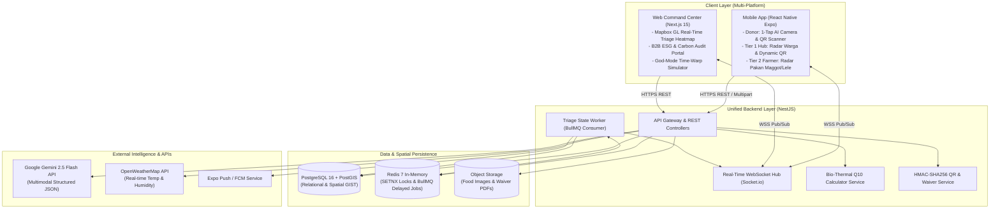
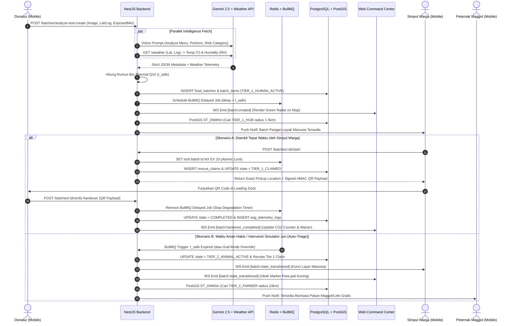

# File 1: `ARCHITECTURE.md`

## 1. Tech Stack & Infrastruktur

| Layer | Teknologi Utama | Fungsi & Justifikasi Arsitektur |
| --- | --- | --- |
| **Monorepo Engine** | Turborepo + pnpm | Orkestrasi *build* paralel dan berbagi kode (*shared types*, *Bio-Thermal SDK*, *Zod schemas*) antara Mobile, Web, dan Backend. |
| **Mobile App** | React Native (Expo SDK 52, TypeScript) | Aplikasi lapangan (*Zero-UI Camera*, *GPS Geolocation*, *Offline HMAC QR Generator/Scanner*, *Push Notifications*). |
| **Web App** | Next.js 15 (App Router, TypeScript) | Command Center pemantauan kota, visualisasi *Mapbox GL JS*, portal unduh *Digital Waiver PDF*, dan panel *God-Mode Simulator*. |
| **Styling & UI** | Tailwind CSS + Shadcn UI + NativeWind | Konsistensi sistem desain antara Web Dashboard (*dark mode telemetry*) dan komponen Mobile. |
| **Unified Backend** | Node.js (NestJS, TypeScript) | Arsitektur modular penyedia REST API, WebSocket Gateway (Socket.io), dan orkestrasi *background workers*. |
| **Database Utama** | PostgreSQL 16 + PostGIS | Penyimpanan relasional transaksional dengan kapabilitas kueri indeks spasial (`GIST`) untuk *hyper-local radius routing*. |
| **State & Queue** | Redis 7 + BullMQ | *Distributed atomic lock* (`SETNX`) pencegah *double-claim*, serta *delayed jobs* untuk mutasi otomatis Tier 1 $\rightarrow$ Tier 2 $\rightarrow$ Tier 3. |
| **AI & Eksternal** | Gemini 2.5 Flash + OpenWeatherMap | Ekstraksi inventaris visual berlatensi rendah ($< 2\text{ detik}$) dengan *Strict JSON Schema* dan pengambilan data cuaca lokal riil. |
| **Object Storage** | Supabase Storage / AWS S3 | Penyimpanan foto *batch* makanan prasmanan/warung terkompresi dan dokumen PDF *Digital Liability Waiver*. |

## 2. System Architecture Diagram

### 2.1 High-Level Component Architecture (`graph TD`)



### 2.2 Real-Time Triage & Handshake Flow (`sequenceDiagram`)



## 3. Directory Structure

```text
sirkula-ai/
├── apps/
│   ├── backend/                                # NestJS Unified Backend Server
│   │   ├── src/
│   │   │   ├── modules/
│   │   │   │   ├── auth/                       # Role-based context & JWT guard
│   │   │   │   ├── batches/                    # Ingestion, PostGIS queries, state mutation
│   │   │   │   ├── vision-ai/                  # Gemini 2.5 Flash multimodal integration
│   │   │   │   ├── weather/                    # OpenWeatherMap client & fallback handler
│   │   │   │   ├── triage-worker/              # BullMQ processors (Tier 1 -> 2 -> 3 & Ripple)
│   │   │   │   ├── claims/                     # Redis SETNX lock, HMAC QR, Digital Waiver
│   │   │   │   ├── esg-analytics/              # Carbon telemetry & PDF certificate generator
│   │   │   │   ├── simulation/                 # God-Mode Time-Warp & Temp override controller
│   │   │   │   └── websocket/                  # Socket.io gateway & room broadcasters
│   │   │   ├── common/                         # Filters, interceptors, guards
│   │   │   ├── config/                         # Env validation
│   │   │   └── main.ts
│   │   └── package.json
│   │
│   ├── mobile/                                 # React Native (Expo Router) Field App
│   │   ├── src/
│   │   │   ├── app/
│   │   │   │   ├── (donor)/                    # Zero-UI camera, preview card, QR scanner
│   │   │   │   ├── (tier1-hub)/                # Dignity radar map, mission claim, dynamic QR
│   │   │   │   ├── (tier2-farmer)/             # Biomass radar, feed value converter, QR pass
│   │   │   │   └── _layout.tsx                 # Dynamic Role Switcher header bar
│   │   │   ├── components/                     # Countdown badge, offline sync banner
│   │   │   ├── hooks/                          # useSocketSync, useOfflineHandshake, useLocation
│   │   │   ├── store/                          # Zustand stores (activeRole, offlineQueue)
│   │   │   └── utils/                          # Local HMAC verifier for basement/offline scan
│   │   └── app.json
│   │
│   └── web/                                    # Next.js 15 Command Center & Simulator
│       ├── src/
│       │   ├── app/
│       │   │   ├── dashboard/                  # Live Mapbox triage monitor & telemetry stream
│       │   │   ├── legal-vault/                # Digital Liability Waiver registry & PDF export
│       │   │   └── layout.tsx
│       │   ├── components/
│       │   │   ├── map/                        # Mapbox GL canvas, ripple rings, route vectors
│       │   │   ├── simulator/                  # God-Mode temperature slider & instant spoil button
│       │   │   └── esg/                        # Real-time CO2e & Methane animated counters
│       │   ├── hooks/                          # useRealtimeMapStream
│       │   └── store/                          # Zustand command center state
│       └── next.config.ts
│
├── packages/
│   ├── bio-thermal-sdk/                        # Pure TS functions: Rumus Q10, konversi CO2e & pakan
│   │   ├── src/
│   │   │   ├── q10-calculator.ts
│   │   │   ├── esg-converter.ts
│   │   │   └── index.ts
│   │   └── package.json
│   │
│   ├── shared-types/                           # Kontrak data tunggal lintas platform
│   │   ├── src/
│   │   │   ├── dtoSchemas.ts                   # Zod validation schemas
│   │   │   ├── websocketEvents.ts              # Typed Socket.io event payloads
│   │   │   └── enums.ts                        # BatchState, ActorRole, FoodCategory
│   │   └── package.json
│   │
│   └── database/                               # SQL migrations, seeders (Bandung/Jakarta coords)
│       ├── migrations/
│       │   └── 001_initial_schema.sql
│       └── seed.ts
│
├── docker-compose.yml                          # PostgreSQL 16 (PostGIS) + Redis 7 local container
├── turbo.json
└── package.json

```

## 4. Data Flow & State Management

### 4.1 Alur Ingesti & Kalkulasi Bio-Thermal (Write Path)

1. **Akuisisi Citra:** Pengguna `DONOR` di Mobile mengambil foto. Gambar dikompresi di sisi klien menjadi maks `1024x1024px` ($\le 800\text{ KB}$) untuk meminimalkan latensi unggah, lalu dikirim via `multipart/form-data` bersama koordinat GPS dan `exposed_minutes`.
2. **Eksekusi Paralel Backend:** NestJS mengunggah foto ke Object Storage secara asinkron sembari memanggil **Gemini 2.5 Flash API** dan **OpenWeatherMap API** secara paralel menggunakan `Promise.allSettled()`. Jika API cuaca gagal/timeout ($> 1.000\text{ ms}$), sistem otomatis memakai parameter *fallback* tropis ($T = 30.0^\circ\text{C}, RH = 75\%$).
3. **Kalkulasi Deterministik:** Output JSON dari Gemini (kategori risiko makanan & $t_{\text{base}}$) digabungkan dengan suhu/kelembapan cuaca di dalam modul `@sirkula/bio-thermal-sdk` untuk menghasilkan timestamp `tier1_expires_at` dan `tier2_expires_at`.
4. **Persistensi & Penjadwalan Timer:** Data disimpan ke PostgreSQL dalam satu transaksi database. Setelah *commit*, Backend mendaftarkan 3 *delayed jobs* di BullMQ (Redis):
* `job:ripple-expand:<batch_id>` (berjalan setiap 10 menit jika belum diklaim untuk memperluas radius PostGIS dari $1,5\text{ km} \rightarrow 3\text{ km} \rightarrow 5\text{ km}$).
* `job:Mutate-tier2:<batch_id>` (dieksekusi tepat pada `tier1_expires_at`).
* `job:mutate-tier3:<batch_id>` (dieksekusi tepat pada `tier2_expires_at`).


### 4.2 Manajemen State Terdistribusi & Pencegahan Race Condition

1. **Single Source of Truth:** Status siklus hidup *batch* (`current_state`) dikendalikan sepenuhnya oleh Backend (PostgreSQL + Redis). Klien (Web dan Mobile) tidak pernah menghitung perpindahan *tier* secara sepihak, melainkan hanya me-*render* hitung mundur visual berdasarkan `tier1_expires_at` dan bereaksi terhadap *event* WebSocket.
2. **Atomic Claim Locking:** Saat beberapa pengguna `TIER_1_HUB` menekan tombol klaim bersamaan, endpoint klaim mengeksekusi `SET lock:batch:<id> <actor_id> NX EX 10` di Redis. Hanya pemenang *lock* yang dapat mengubah status database menjadi `TIER_1_CLAIMED`.
3. **Offline-First Handshake State (Mobile):** Ketika kurir tiba di *loading dock* basement tanpa sinyal, aplikasi Mobile Donatur memverifikasi tanda tangan kriptografi `HMAC-SHA256` yang tertanam di dalam QR Code kurir secara lokal menggunakan *shared secret key*. Transaksi disimpan di antrean `AsyncStorage` (Zustand Persist) dengan timestamp perangkat dan otomatis disinkronkan ke endpoint `/verify-handover` saat koneksi kembali aktif.

### 4.3 Sinkronisasi State Real-Time di Klien (Web & Mobile)

* **Server-State Caching:** Menggunakan **TanStack Query (React Query)** untuk pengambilan data awal (`GET /batches/nearby` dan `GET /analytics/esg-summary`).
* **Event-Driven Cache Invalidation:** Klien membuka koneksi persisten Socket.io. Saat menerima *event* `batch:created`, `batch:state_transitioned`, `batch:claimed`, atau `batch:handover_completed`, listener Socket.io langsung memperbarui *cache* TanStack Query dan Zustand store secara mutatif (`queryClient.setQueryData`), menghasilkan pembaruan UI instan ($< 100\text{ ms}$) tanpa *network refetch* tambahan.
