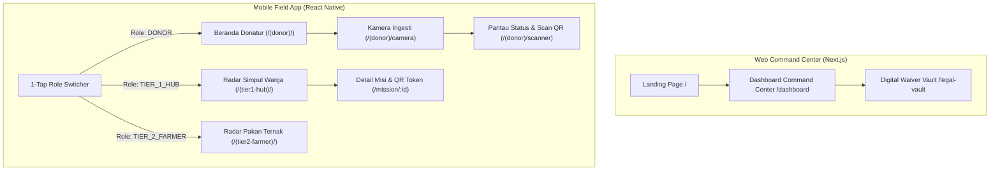

# DESIGN.md — Spesifikasi Teknis UI/UX & Design System (SIRKULA-AI)

Dokumen ini mendefinisikan standar spesifikasi teknis UI/UX, Design System, tata letak informasi, serta perilaku interaksi untuk platform **SIRKULA-AI**. Dokumen ini menjadi acuan utama bagi AI Coding Assistant dan pengembang frontend saat mengimplementasikan antarmuka Web Command Center dan Mobile Field App agar konsisten, modular, serta sinkron dengan backend.

---

## 1. Design Direction & Design Tokens

### 1.1 Visual Style & Theme

* **Karakter & Konsep Visual:** Mengusung tema *Eco-Tech & Human Centric*. Menggabungkan nuansa keberlanjutan lingkungan (*Sustainability*) dengan ketepatan operasional berbasis kecerdasan buatan (*AI & Triage Analytics*).
* **Dukungan Mode:** Menggunakan skema warna default *Light Mode* yang bersih untuk visibilitas lapangan, serta *Dark Mode* eksklusif untuk *Web Command Center* demi kenyamanan pemantauan operasional makro dan proyektor presentasi.

### 1.2 Color Palette & Semantic Tokens

Seluruh warna didefinisikan menggunakan variabel CSS/Tailwind yang konsisten:

| Token Kategori | Nama Token | Hex Code (Light) | Hex Code (Dark) | Fungsi / Penggunaan Utama |
| --- | --- | --- | --- | --- |
| **Primary** | `primary-500` | `#0B7A6B`

 | `#0E9F8B` | Tombol utama, badge aktif, brand highlight |
| **Primary** | `primary-600` | `#085E52` | `#0B7A6B` | State Hover tombol utama |
| **Secondary** | `secondary-500` | `#0FA690`

 | `#12C4AA` | Aksen grafis, ikon interaktif sekunder |
| **Accent** | `accent-500` | `#F59E0B` | `#FBBF24` | Status Tier 2 (Pakan Ternak / Peringatan) |
| **Neutral** | `bg-base` | `#F5FAF9`

 | `#0F172A` | Warna latar belakang layar utama (`background`) |
| **Neutral** | `surface` | `#FFFFFF` | `#1E293B` | Warna latar kartu, modal, dan navigasi (`surface`) |
| **Neutral** | `border` | `#E6F7F4`

 | `#334155` | Garis pembatas komponen dan divider |
| **Neutral** | `text-primary` | `#0F172A`

 | `#F8FAFC` | Teks utama / judul (`text`) |
| **Neutral** | `text-muted` | `#64748B` | `#94A3B8` | Teks sekunder, deskripsi, caption |
| **Semantic** | `success` | `#10B981` | `#34D399` | Status Selesai, Tier 1 aktif, indikator hijau |
| **Semantic** | `warning` | `#F59E0B` | `#FBBF24` | Peringatan waktu aman hampir habis |
| **Semantic** | `error` | `#EF4444` | #F87171 | Status Kedaluwarsa, error validasi, tombol hapus |
| **Semantic** | `info` | `#3B82F6` | `#60A5FA` | Informasi sistem, petunjuk navigasi |

### 1.3 Typography Scale

* **Font Family Utama:** `Plus Jakarta Sans` (sans-serif) untuk seluruh elemen UI teks dan tombol.


* **Font Family Monospace:** `JetBrains Mono` / `Fira Code` untuk menampilkan hash kriptografiwaiver, koordinat GPS, dan timer hitung mundur.

| Level Teks | Ukuran (Desktop/Mobile) | Font Weight | Line Height | Keterangan Penggunaan |
| --- | --- | --- | --- | --- |
| **Heading 1** | 32px / 28px | Bold (700) | 1.25 | Judul Halaman Utama / Hero Title |
| **Heading 2** | 24px / 20px | SemiBold (600) | 1.35 | Judul Bagian / Nama Modal |
| **Heading 3** | 18px / 16px | SemiBold (600) | 1.40 | Judul Kartu (*Card Title*) |
| **Body** | 14px / 14px | Regular (400) | 1.50 | Teks isi paragraf standar, daftar item |
| **Caption** | 12px / 12px | Medium (500) | 1.40 | Label kecil, timestamp, badge status |
| **Button** | 14px / 14px | SemiBold (600) | 1.00 | Teks di dalam tombol interaktif |

### 1.4 Spacing, Layout & Effects

* **Spacing Grid System:** Menggunakan kelipatan dasar **4px / 8px** (`space-1` = 4px, `space-2` = 8px, `space-4` = 16px, `space-6` = 24px).
* **Container Max-Width:** Web Command Center menggunakan lebar maksimum `1440px` dengan *fluid padding* `24px`. Mobile App dirancang dengan lebar responsif penuh (`100%`) dan *safe area padding* vertikal.
* **Border Radius:** Kartu dan tombol menggunakan kelengkungan `rounded-xl` (12px) untuk kesan ramah dan modern; input form menggunakan `rounded-lg` (8px).
* **Elevation / Shadow:**
* `shadow-sm`: `0 1px 2px 0 rgba(0, 0, 0, 0.05)` (untuk kartu standar).
* `shadow-lg`: `0 10px 15px -3px rgba(11, 122, 107, 0.1)` (untuk modal aktif dan elemen mengambang).


---

## 2. Information Architecture & Routing Map

### 2.1 Navigation Pattern

* **Mobile App:** Menggunakan **Bottom Navigation Bar** persisten yang visibilitas tab-nya berubah dinamis berdasarkan *Role Aktor* yang aktif via *1-Tap Role Switcher*:
* Tab Donatur: *Beranda*, *Kamera Ingesti*, *Riwayat*, *Profil*.
* Tab Simpul Hub (Tier 1): *Beranda Radar*, *Misi Aktif*, *Scan QR*, *Profil*.
* Tab Peternak (Tier 2): *Beranda Pakan*, *Misi Biomasa*, *Riwayat*, *Profil*.


* **Web Command Center:** Menggunakan **Fixed Left Sidebar** untuk navigasi makro modul dashboard, disertai **Top Header Bar** yang memuat indikator status koneksi WebSocket, jam lokal, dan panel God-Mode Simulator.

### 2.2 Route Table

| Path / Route Name | Target Platform | Deskripsi Halaman | Parameter Dinamis (`:id`) | Proteksi Auth & Role |
| --- | --- | --- | --- | --- |
| `/` | Web | Halaman Landing Page publik & portal informasi dampak ESG | *None* | Publik |
| `/dashboard` | Web | Command Center utama (Peta Mapbox GL & Telemetri Real-Time) | *None* | `SIMULATOR_ADMIN`, `ESG_AUDITOR` |
| `/legal-vault` | Web | Registry unduh sertifikat Digital Liability Waiver (PDF) | *None* | `ESG_AUDITOR` |
| `/(donor)/` | Mobile | Beranda Donatur & Tombol Akses Cepat Kamera AI | *None* | `DONOR` |
| `/(donor)/camera` | Mobile | Layar Tangkap Kamera Ingesti & Slider Jam Matang | *None* | `DONOR` |
| `/(tier1-hub)/` | Mobile | Radar Makanan Layak Manusia (Tier 1) terdekat | *None* | `TIER_1_HUB` |
| `/(tier1-hub)/mission/:id` | Mobile | Detail Misi Penjemputan & Tampilan QR Dinamis | `id` (Batch UUID) | `TIER_1_HUB` |
| `/(tier2-farmer)/` | Mobile | Radar Biomasa Pakan Organik & Kalkulator Nilai Ternak | *None* | `TIER_2_FARMER` |
| `/(donor)/scanner` | Mobile | Pemindai QR Handshake untuk Donatur di Loading Dock | *None* | `DONOR` |

### 2.3 Screen Flow Diagram (Mermaid.js)



---

## 3. Reusable UI Component Library

Berikut adalah spesifikasi komponen UI modular yang wajib diimplementasikan di folder `components/`:

### 1. Button (`Button.tsx`)

* **Props:** `variant` (`primary` | `secondary` | `outline` | `danger`), `size` (`sm` | `md` | `lg`), `isLoading` (`boolean`), `leftIcon`, `rightIcon`, `disabled`.
* **States:**
* *Default:* Background Primary-500, teks putih, sudut rounded-xl.
* *Hover:* Background Primary-600, elevasi shadow-sm meningkat.
* *Focused:* Ring border 2px offset dengan warna Primary-300.
* *Disabled / Loading:* Opasitas 60%, spinner menggantikan teks tombol, tidak merespons klik.


### 2. Input Field / Slider (`Input.tsx` & `ExposureSlider.tsx`)

* **Props:** `label`, `error`, `helperText`, `leftIcon`, `value`, `onChange`.
* **States:**
* *Default:* Border abu-abu netral (`border`), background putih/surface.
* *Focused:* Border berubah menjadi Primary-500 dengan efek glow tipis.
* *Error:* Border dan teks helper berubah menjadi merah (`error`).


### 3. Card Container (`Card.tsx`)

* **Props:** `elevation` (`flat` | `raised`), `padding` (`sm` | `md` | `lg`), `onClick`.
* **States:** Background surface, border tipis, memberikan efek *scale up* ringan (1.01) saat disentuh jika bernilai interaktif (`onClick` tersedia).

### 4. Status Badge (`Badge.tsx`)

* **Props:** `status` (`TIER_1_HUMAN_ACTIVE` | `TIER_1_CLAIMED` | `TIER_2_ANIMAL_ACTIVE` | `COMPLETED`), `size`.
* **States:** Menyesuaikan warna semantik otomatis (Hijau untuk Tier 1, Kuning-Oranye untuk Tier 2, Merah untuk Kedaluwarsa, Biru untuk Selesai).

### 5. Toast / Alert Banner (`Toast.tsx`)

* **Props:** `type` (`success` | `warning` | `error` | `info`), `title`, `message`, `onClose`.
* **States:** Muncul melayang di bagian atas layar dengan animasi *slide-down*, otomatis tertutup setelah 4 detik atau ditekan tombol silang.

---

## 4. Screen-by-Screen / Page Specifications

### 4.1 Layar Kamera Ingesti Donatur (`apps/mobile/src/app/(donor)/camera.tsx`)

* **Layout & Component Hierarchy:**
1. *Header:* Judul layar "Pindai Sisa Pangan" & Tombol Tutup (`X`).
2. *Camera Viewfinder:* Area pratinjau kamera penuh dengan bingkai pemandu sudut hijau.
3. *Control Bar (Bawah):* Tombol Shutter Bulat besar di tengah, ikon galeri di kiri.
4. *Exposure Slider Modal / Panel:* Pilihan cepat durasi paparan sejak matang (`Baru Matang`, `2 Jam Lalu`, `4 Jam Lalu`) dan Toggle `Ruangan Ber-AC`.


* **Data Binding & API Mapping:**
* Saat tombol shutter ditekan, memanggil endpoint `POST /api/v1/batches/analyze-and-create` dengan mengirimkan payload *multipart/form-data* (gambar terkompresi, koordinat GPS lat/lng, `exposed_minutes`, `is_ac_room`).


* **Interactive Behavior & Validation:**
* Tombol Shutter memicu suara rana buatan dan menampilkan *Loading Overlay* transparan bertuliskan *"AI Sedang Menganalisis Menu & Cuaca..."*.
* Jika berhasil, navigasi otomatis berpindah ke Modal Pratinjau Rincian Hasil AI.


* **Strict UI Guardrails:**
* Hanya menampilkan *slider* pilihan jam paparan yang diizinkan (tidak boleh mengetik manual angka jam untuk menjaga kecepatan *Zero-UI* $\le 15\text{ detik}$).


### 4.2 Layar Radar Misi Simpul Warga (`apps/mobile/src/app/(tier1-hub)/index.tsx`)

* **Layout & Component Hierarchy:**
1. *Top Bar:* Indikator wilayah aktif (misal: "Radius Dago — 1.5 km") dan status online WebSocket.
2. *Active Mission List:* Daftar kartu batch makanan berstatus `TIER_1_HUMAN_ACTIVE`.
3. *Mission Card:* Menampilkan ringkasan menu (misal: "Gulai Cincang & Nasi"), estimasi porsi, *Bio-Thermal Countdown Timer* (berdetak mundur warna hijau/merah), dan tombol aksi **"Ambil Misi Penyelamatan"**.


* **Data Binding & API Mapping:**
* Memuat data saat halaman dibuka via `GET /api/v1/batches/nearby` dengan parameter aktor role `TIER_1_HUB`.
* Mendengarkan *event* WebSocket `batch:created` dan `batch:state_transitioned` untuk menambah atau menghapus kartu secara *real-time*.


* **Interactive Behavior & Validation:**
* Menekan tombol ambil misi memicu *Atomic Lock* ke `POST /api/v1/batches/:id/claim`. Jika sukses, layar beralih ke rute `/mission/:id` yang menampilkan petunjuk pintu belakang dan QR Token dinamis.


### 4.3 Web Command Center Dashboard (`apps/web/src/app/dashboard/page.tsx`)

* **Layout & Component Hierarchy:**
1. *Header Navbar:* Logo Pangan Pulse/Sirkula-AI, menu tautan, status koneksi WebSocket, dan Dropdown profil Admin.
2. *Main Grid Split:*
* *Kiri (65% Lebar):* Peta interaktif Mapbox GL JS dengan titik penanda radar berdenyut (*pulsing ripple*).
* *Kanan (35% Lebar):* Feed Audit Log Transaksi *Real-Time* dan panel **God-Mode Simulator**.


3. *Footer Bar:* Metrik ESG Agregat (`Total Porsi`, `Kg Food Waste Dicegah`, `Emisi CO2e Dicegah`).


* **Data Binding & API Mapping:**
* Memuat rekapitulasi awal via `GET /api/v1/analytics/esg-summary` dan `GET /api/v1/batches/nearby`.
* Menggunakan *Socket.io hooks* untuk memperbarui marker peta dan counter metrik ESG secara instan saat terjadi transaksi serah terima.


---

## 5. UI States, Edge Cases & Microanimations

### 5.1 Global State Views

* **Loading State:** Wajib menggunakan *Skeleton Loading* berbentuk kotak abu-abu berdenyut (*shimmer effect*) untuk kartu batch dan daftar radar, menghindari penggunaan spinner melingkar penuh yang mengganggu visual.
* **Empty State:** Ditampilkan saat tidak ada batch aktif di radius terdekat. Ilustrasi ikon keranjang kosong, teks judul *"Belum ada sisa pangan aktif di radius Anda"*, dan tombol sekunder *"Perluas Radius Pencarian"*.
* **Error State:** Banner merah di bagian atas layar dengan tombol *"Coba Lagi"* jika koneksi internet terputus atau API gagal merespons.

### 5.2 Edge Case Handling

* **Teks Terlalu Panjang:** Nama menu yang panjang pada kartu batch wajib menerapkan properti CSS `truncate` (`overflow: hidden; text-overflow: ellipsis; white-space: nowrap;`) atau dibungkus maksimal 2 baris (`line-clamp-2`).
* **Kedaluwarsa Sesi (Token Expired):** Jika API mengembalikan `HTTP 401 Unauthorized`, aplikasi otomatis menghapus session Zustand dan mengarahkan pengguna kembali ke layar pemilihan peran awal tanpa merusak state aplikasi.
* **Pencegahan Double-Submit:** Setiap tombol aksi utama (`Ambil Misi`, `Rilis Donasi`, `Verifikasi QR`) otomatis masuk ke state `disabled` dan menampilkan status *Loading* seketika setelah sentuhan pertama ditekan.

### 5.3 Transitions & Microanimations

* **Durasi Transisi Halaman:** Menggunakan standar durasi `200ms` dengan kurva easing `cubic-bezier(0.4, 0, 0.2, 1)` untuk perpindahan layar modular di Mobile.
* **Animasi Counter ESG:** Angka pada *EsgMetricsBar* di Web Command Center wajib menggunakan efek animasi bergulir naik (*count-up animation*) setiap kali *event* WebSocket `batch:handover_completed` diterima.

---

## 6. Standardized Mock Data / UI Fixtures

Objek JSON di bawah ini dapat digunakan langsung oleh tim frontend untuk *prototyping* dan pengujian komponen UI sebelum integrasi penuh ke backend:

### A. Mock Data: Rincian Batch Ingesti (`food_batches` + `batch_items`)

```json
{
  "batch_id": "b7c2a1e4-9f83-4312-b58a-6412bf709123",
  "donor_id": "a1b2c3d4-e5f6-7a8b-9c0d-1e2f3a4b5c6d",
  "batch_summary": "Gulai Cincang Sapi & Nasi Putih",
  "highest_risk_category": "WET_COCONUT_MILK",
  "total_portions": 45,
  "total_weight_kg": 11.50,
  "recommended_container": "2 Box Kontainer Besar / 45 Thinwall",
  "ambient_temp_c": 31.5,
  "humidity_pct": 78,
  "base_shelf_life_min": 120,
  "safe_window_human_min": 74,
  "current_state": "TIER_1_HUMAN_ACTIVE",
  "tier1_expires_at": "2026-11-07T14:35:00.000Z",
  "tier2_expires_at": "2026-11-08T02:35:00.000Z",
  "items": [
    {
      "menu_name": "Gulai Cincang Sapi",
      "category": "WET_COCONUT_MILK",
      "estimated_portions": 25,
      "estimated_weight_kg": 6.50,
      "contains_coconut_milk": true,
      "animal_feed_suitable": true
    },
    {
      "menu_name": "Nasi Putih Hangat",
      "category": "MOIST_PROTEIN_CARB",
      "estimated_portions": 20,
      "estimated_weight_kg": 5.00,
      "contains_coconut_milk": false,
      "animal_feed_suitable": true
    }
  ]
}

```

### B. Mock Data: Rangkuman Telemetri ESG (`esg_telemetry_logs`)

```json
{
  "summary_period": "November 2026",
  "total_batches_rescued": 1248,
  "total_portions_saved": 10942,
  "total_weight_saved_kg": 14480.00,
  "co2e_avoided_kg": 36200.00,
  "methane_ch4_avoided_kg": 2172.000,
  "estimated_feed_savings_idr": 55024000.00,
  "recent_waiver_certificates": [
    {
      "waiver_certificate_no": "SRK-ESG-202611-0942",
      "donor_name": "Resto Melati Dago",
      "receiver_name": "Masjid Al-Ikhlas",
      "weight_saved_kg": 11.50,
      "co2e_avoided_kg": 28.75,
      "recorded_at": "2026-11-07T13:20:00.000Z",
      "waiver_signature_hash": "e3b0c44298fc1c149afbf4c8996fb92427ae41e4649b934ca495991b7852b855"
    }
  ]
}
```